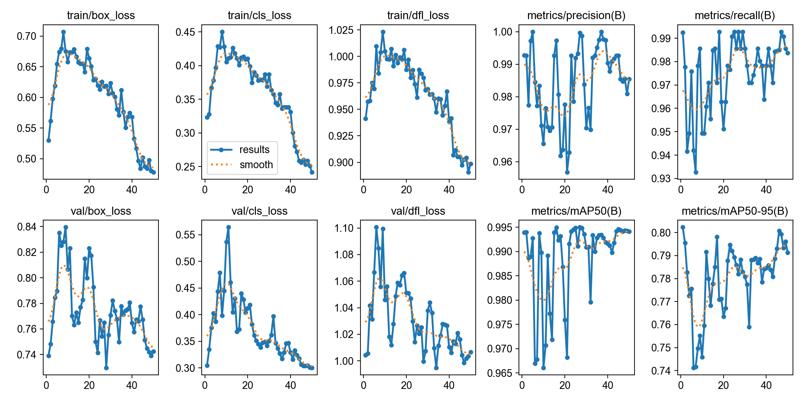
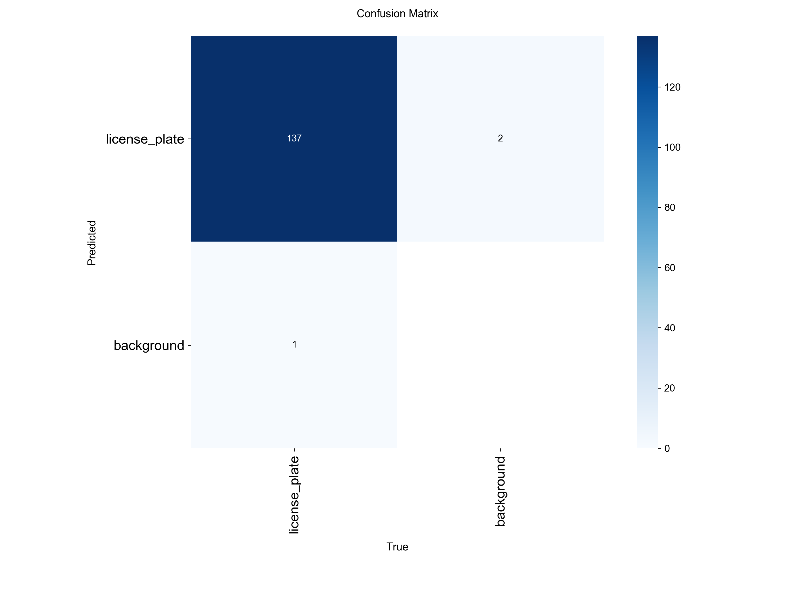

# License Plate Recognition with Edge Model Deployment

Project Goal: Detect license plates in images and deploy a plate recognizer on an RV1106 camera platform.

This project was developed during my camera internship. It includes YOLOv8 detection, a desktop detection GUI, and a single-input CNN + TCN/Conv1D recognizer for RV1106 deployment.

## Project Structure

```text
detection/       YOLOv8 training, validation, prediction and GUI
recognition/     Final plate recognizer, training and model conversion
  board/         RV1106 inference and run-only benchmark
  data/          Final PyTorch, ONNX and RKNN models
metrics/         Saved YOLOv8 training log and configuration
assets/          Detection training results
docs/            Experiment history and verification notes
```

The detection and recognition programs are separate. The recognizer takes a cropped plate image; the detection GUI draws bounding boxes. A combined live camera pipeline is not included.

## Dataset

Detection Dataset: 519-image license plate subset, YOLO format, one class: `license_plate`.

| Split | Images |
| --- | ---: |
| Train | 347 |
| Validation | 111 |
| Test | 61 |

The saved test folder has 50 label files for 61 images. Check the remaining images before using this split to report test metrics.

Recognition Dataset: Cropped Chinese plates with 7 characters, stored as images and tab-separated labels.

| Split | Images |
| --- | ---: |
| Train | 15,026 |
| Validation | 3,628 |
| Test | 3,643 |

```text
recognition/processed/
  train/
    images/
    label.txt
  valid/
    images/
    label.txt
  test/
    images/
    label.txt
```

Each line in `label.txt` contains `image_name<TAB>plate_text`.

Datasets are not included in this repository. Keep the original detection split when comparing with the saved results. `dataset_assignment.py` creates a new 70% / 20% / 10% split and does not reproduce the original 347 / 111 / 61 split.

## Model

Detection Model: YOLOv8n.

Final Recognition Model: CNN + horizontal TCN/Conv1D.

- CNN channels: 64, 128, 256
- Residual Conv1D dilation: 1, 2, 4, 1
- Input: RGB image, `1 x 3 x 64 x 256`, float32 in `[0, 1]`
- Output: `1 x 8 x 70` logits
- 8 output positions: 7 plate characters and EOS
- Parameters: 2,035,014

The earlier CNN + Transformer decoder was replaced during deployment. The final model uses one image input and does not require decoder tokens or autoregressive inference.

## Results

| Item | Result | Source |
| --- | ---: | --- |
| Detection validation mAP50 | 99.39% | Saved `train8` best checkpoint |
| Detection validation mAP50-95 | 80.23% | Saved `train8` best checkpoint |
| Recognition validation token accuracy, including EOS | 99.39% | Final checkpoint, epoch 40 |
| Recognition validation full-plate accuracy, including EOS | 96.44% | Final checkpoint, epoch 40 |
| RV1106 run-only latency | avg 3.129 ms, min 3.119 ms, max 3.201 ms | Recorded board result |
| RV1106 sample test | 20 / 20 correct | Recorded board result |

The board latency measures `rknn_run` only. It excludes image capture, resize, input transfer, output synchronization and decoding. The 20-image board result is a sample check.

Detection mAP is reported separately from recognition accuracy. The original recognition metric includes EOS and ignores PAD. The saved recognition CSV contains only its header, so the final validation numbers are taken from the checkpoint rather than a reconstructed training curve.

Training Results:



Validation Confusion Matrix:



## Environment

```bash
git clone https://github.com/Harryxing213/License-Plate-Recognition-with-Edge-Model-Deployment.git
cd License-Plate-Recognition-with-Edge-Model-Deployment

python -m venv .venv
source .venv/bin/activate
python -m pip install -r requirements.txt
```

The GUI also requires Tkinter. RKNN Toolkit2 runs in a separate Linux environment with RV1106 support. The RV1106 SDK supplies the compiler, `rknn_api.h` and `librknnmrt.so`.

Model Files:

- [detection/weights/best.pt](detection/weights/best.pt)
- [recognition/data/model_single_input_v2.pth](recognition/data/model_single_input_v2.pth)
- [recognition/data/model_batchnorm.pth](recognition/data/model_batchnorm.pth): CNN initialization for training
- [recognition/data/plate_recognizer_single_input_v2.onnx](recognition/data/plate_recognizer_single_input_v2.onnx)
- [recognition/data/plate_recognizer_single_input_v2_uint8_w8a8.rknn](recognition/data/plate_recognizer_single_input_v2_uint8_w8a8.rknn)

The final model files and the original RV1106 test binaries are included. New training outputs, datasets and intermediate exports are ignored by Git. Model SHA-256 checksums are recorded in [models.sha256](metrics/models.sha256).

## Detection

Place the original data under `detection/train_exp/{train,valid,test}/{images,labels}`.

To train a new model:

```bash
python detection/yolov8_pipeline.py train --epochs 50 --batch 16 --imgsz 640
```

This starts a new YOLOv8n run. The saved `train8` experiment used 50 epochs, batch 16 and image size 640, initialized from `train6/weights/last.pt`. Its initialization history is recorded in `metrics/detection_train8_args.yaml`.

To validate or test the supplied checkpoint:

```bash
python detection/yolov8_pipeline.py val
python detection/yolov8_pipeline.py test
```

To detect a new image or folder:

```bash
python detection/yolov8_pipeline.py predict --source /path/to/image_or_folder
```

To open the GUI:

```bash
python detection/detect.py
```

Select the model, select an image or folder, then start detection. Outputs are saved under `detection/runs/detect/`.

For a newly trained model, pass its path with `--weights` or select it in the GUI. The default weights remain the supplied final checkpoint.

## Recognition

To recognize a cropped plate image or folder:

```bash
python recognition/predict.py --source /path/to/cropped_plate.jpg
```

To evaluate a split:

```bash
python recognition/testing.py
```

To train a new model:

```bash
python recognition/training_single_input_v2.py \
  --epochs 40 --batch_size 64 --lr 3e-4 --num_workers 0
```

The training script initializes the CNN from `data/model_batchnorm.pth`. New checkpoints and logs are saved under `recognition/data/checkpoints/`.

## Export ONNX

```bash
python recognition/export_single_input_v2_onnx.py
```

This exports the supplied final checkpoint to `recognition/data/exports/plate_recognizer_single_input_v2.onnx`. To export a new checkpoint, pass `--checkpoint data/checkpoints/model_single_input_v2.pth`.

## Convert RKNN

Run these commands in the RKNN Toolkit2 Linux environment, with the recognition data available there:

```bash
python recognition/prepare_rknn_dataset_single_input.py --count 200

python recognition/convert_to_rknn.py \
  --onnx exports/plate_recognizer_single_input_v2.onnx
```

The calibration list contains absolute image paths and must be regenerated in the conversion environment. RKNN applies `/255` normalization; calibration images use pixel values in `[0, 255]`.

The final conversion route is W8A8 INT8 for RV1106. The new RKNN model is saved under `recognition/data/exports/`.

## Board Test

This repository includes the original RV1106 binaries under `recognition/board/bin/`. To rebuild them with your matching RV1106 SDK:

```bash
make -B -C recognition/board \
  CC=/path/to/rv1106-cross-gcc \
  RKNN_INCLUDE=/path/to/rknn/include \
  RKNN_LIB=/path/to/rknn/lib
```

Prepare board inputs:

```bash
python recognition/prepare_board_test_raws.py --count 20
```

This creates RGB NHWC INT8 inputs using `pixel - 128`, matching the supplied model's original board test. Check input quantization and stride before using a different RKNN model.

To test the first sample with the supplied final model:

```bash
adb push recognition/data/plate_recognizer_single_input_v2_uint8_w8a8.rknn /tmp/
adb push recognition/data/board_test_v2_raw/0000_0.raw /tmp/
adb push recognition/board/bin/rknn_smoke_zero_copy_logical_output /tmp/
adb shell chmod +x /tmp/rknn_smoke_zero_copy_logical_output
adb shell /tmp/rknn_smoke_zero_copy_logical_output \
  /tmp/plate_recognizer_single_input_v2_uint8_w8a8.rknn /tmp/0000_0.raw
```

`0000_0.raw` is the first input generated from the original test split. For another dataset, use the filename in the generated `manifest.tsv`. The board tool prints province tokens in pinyin and the remaining characters directly.

## Benchmark

```bash
adb push recognition/board/bin/rknn_benchmark_run_only /tmp/
adb shell chmod +x /tmp/rknn_benchmark_run_only
adb shell /tmp/rknn_benchmark_run_only \
  /tmp/plate_recognizer_single_input_v2_uint8_w8a8.rknn /tmp/0000_0.raw 200
```

The benchmark performs 10 warm-up runs, then reports the average, minimum and maximum time for the requested number of `rknn_run` calls.

See [Experiment History](docs/experiment_history.md) and [Verification](docs/verification.md) for the development routes and current validation scope.
